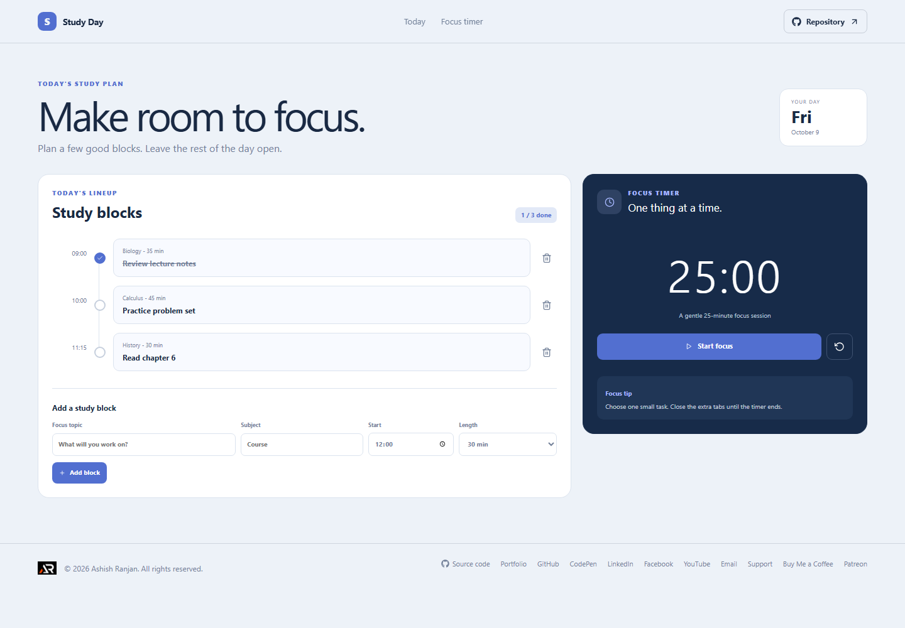

# Study Day

Study Day combines a simple daily study schedule with a focus timer for starting one task at a time.

Live site: https://a2rp.github.io/study-session-planner/

## How to use it

Add a block with a topic, subject, start time, and length. Mark blocks done from the timeline. Start or pause the 25-minute focus timer and reset it when needed.

## Features

- Study blocks sorted by start time
- Completion toggle for each scheduled block
- Add a topic, subject, time, and session length
- Confirmation before removing a block
- Start, pause, and reset a 25-minute focus timer

## Data and limits

The daily study blocks are stored in localStorage. Timer progress lives only in the current page and resets when the page is reloaded.

The planner has no recurring schedules, notifications, or cross-device sync.

## Run locally

Install Node.js, then run these commands from the project folder:

    npm install
    npm run dev

## Checks and deployment

    npm run lint
    npm run build
    npm run deploy

The deploy command builds the site and publishes the contents of dist to the gh-pages branch. The project is configured for GitHub Pages at https://a2rp.github.io/study-session-planner/.

## Future improvements

These are ideas only and are not implemented yet:

- Add recurring weekly plans (idea, not implemented)
- Save focus timer preferences (idea, not implemented)
- Show study totals by subject (idea, not implemented)

## Links

- Portfolio: [https://www.ashishranjan.net](https://www.ashishranjan.net)
- GitHub: [https://github.com/a2rp](https://github.com/a2rp)
- CodePen: [https://codepen.io/ash1198](https://codepen.io/ash1198)
- LinkedIn: [https://www.linkedin.com/in/aashishranjan](https://www.linkedin.com/in/aashishranjan)
- Facebook: [https://www.facebook.com/theash.ashish/](https://www.facebook.com/theash.ashish/)
- YouTube: [https://www.youtube.com/@ashishranjan-ashz?sub_confirmation=1](https://www.youtube.com/@ashishranjan-ashz?sub_confirmation=1)
- Email: [mailto:ash.ranjan09@gmail.com](mailto:ash.ranjan09@gmail.com)

## Support

- Support: [https://a2rp-donation-page.netlify.app/](https://a2rp-donation-page.netlify.app/)
- Buy Me a Coffee: [https://buymeacoffee.com/ashishranjan](https://buymeacoffee.com/ashishranjan)
- Patreon: [https://www.patreon.com/ashishranjan](https://www.patreon.com/ashishranjan)